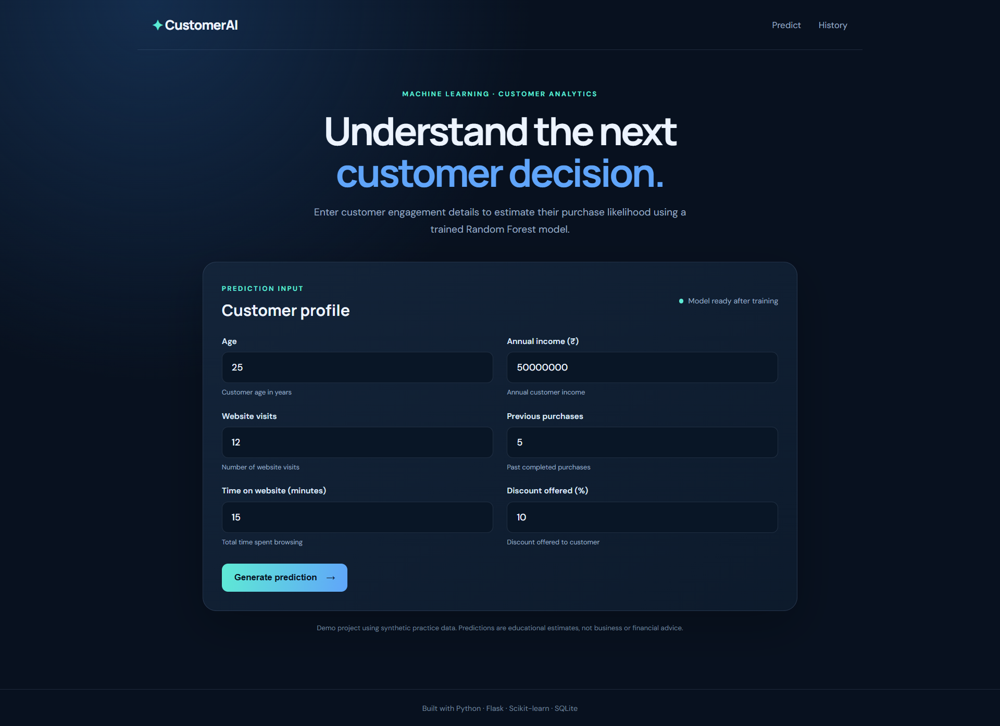
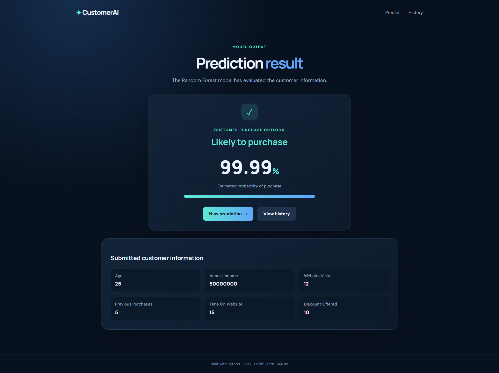
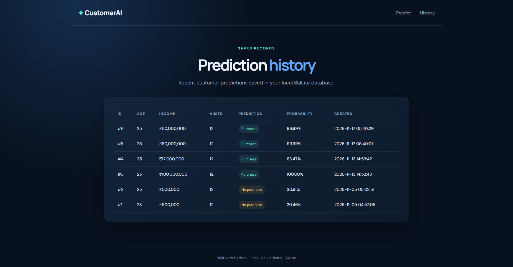

# ✨ CustomerAI — AI-Powered Customer Purchase Prediction System

<div align="center">


<br/>

### Turning Customer Data into Intelligent Business Decisions

A Machine Learning web application that predicts customer purchase behaviour using a trained Random Forest Classifier.

<br/>


<br/><br/>

<a href="#-overview">Overview</a> •
<a href="#-application-preview">Screenshots</a> •
<a href="#-features">Features</a> •
<a href="#-machine-learning-workflow">ML Workflow</a> •
<a href="#-installation-and-setup">Installation</a>

</div>

---

## 🚀 Overview

**CustomerAI** is an AI-powered customer purchase prediction application developed using Python, Flask, and Machine Learning.

The application analyzes customer information and estimates whether a customer is likely to purchase a product.

Using a trained **Random Forest Classifier**, it generates a prediction and displays the estimated purchase probability through a modern, interactive dashboard.

The application also stores previous predictions in a local SQLite database, allowing users to access their prediction history.

## 🖥️ Application Preview

### 1. Customer Prediction Dashboard

Enter customer information to generate a purchase prediction.



### 2. Machine Learning Prediction Result

View the predicted purchase outcome and estimated probability.



### 3. Prediction History Dashboard

View previously saved predictions with customer information, prediction results, probabilities, and timestamps.



---

## ✨ Features

- 🤖 **Machine Learning Prediction** — Predict customer purchase behaviour using Random Forest.
- 📊 **Probability Estimation** — Display the estimated probability of a customer purchase.
- 👤 **Customer Profile Input** — Enter customer engagement and behavioural information.
- 🗂️ **Prediction History** — Save and view previous prediction records.
- 🛢️ **SQLite Database** — Store prediction records locally.
- 🎨 **Modern Dashboard** — Professional dark-themed interface with gradient effects.
- ⚡ **Interactive Results** — Dedicated prediction result page.
- 🔄 **New Prediction** — Generate another prediction easily.
- 📱 **Responsive Interface** — Dashboard designed for different screen sizes.

## 🧠 Machine Learning Workflow

```text
          Customer Information
                   |
                   v
           Data Preprocessing
                   |
                   v
           Feature Preparation
                   |
                   v
       Trained Random Forest Model
                   |
                   v
          Purchase Prediction
                   |
                   v
          Probability Estimation
                   |
                   v
          Display Prediction
                   |
                   v
            Save in SQLite
                   |
                   v
           Prediction History
```

## 📋 Customer Input Features

| Feature | Description |
|---|---|
| Age | Customer age in years |
| Annual Income | Customer annual income in INR |
| Website Visits | Number of website visits |
| Previous Purchases | Number of completed purchases |
| Time on Website | Time spent browsing in minutes |
| Discount Offered | Discount offered to the customer in percentage |

## 🛠️ Technology Stack

| Technology | Purpose |
|---|---|
| Python | Backend programming |
| Flask | Web application framework |
| Scikit-learn | Machine Learning |
| Random Forest | Classification algorithm |
| SQLite | Database management |
| HTML5 | Webpage structure |
| CSS3 | Styling and animations |
| JavaScript | Frontend interactivity |

## 📂 Project Structure

```text
CustomerAI/
│
├── app.py
├── requirements.txt
├── README.md
│
├── model/
│   └── trained_model
│
├── database/
│   └── customer_history.db
│
├── templates/
│   ├── index.html
│   ├── result.html
│   └── history.html
│
├── static/
│   ├── css/
│   ├── js/
│   └── images/
│
└── assets/
    ├── customerai-predict.png
    ├── customerai-result.png
    └── customerai-history.png
```

> Note: This is a suggested project structure. Update it to match your actual repository files and folders.

## ⚙️ Installation and Setup

### Step 1 — Clone the Repository

Replace `YOUR-REPOSITORY` with your actual GitHub repository name.

```bash
git clone https://github.com/tushar123851/YOUR-REPOSITORY.git
```

### Step 2 — Navigate to the Project

```bash
cd YOUR-REPOSITORY
```

### Step 3 — Create a Virtual Environment

```bash
python -m venv venv
```

### Step 4 — Activate the Environment

**Windows PowerShell:**

```powershell
.\venv\Scripts\Activate.ps1
```

### Step 5 — Install Dependencies

```bash
pip install -r requirements.txt
```

### Step 6 — Run the Application

If your main Flask file is named `app.py`:

```bash
python app.py
```

### Step 7 — Open the Application

Visit the following address in your browser:

```text
http://127.0.0.1:5000
```

---

## 📈 Example Prediction

The following example is based on the values visible in the application preview.

| Customer Attribute | Example Value |
|---|---:|
| Age | 25 |
| Annual Income | ₹50,000,000 |
| Website Visits | 12 |
| Previous Purchases | 5 |
| Time on Website | 15 minutes |
| Discount Offered | 10% |

### Example Model Output

<div align="center">

### 🟢 Likely to Purchase

# 99.99%

Estimated probability shown in the example application.

</div>

> Important: This is an example prediction from the screenshot, not a verified model accuracy score. Prediction probabilities are not guarantees of actual customer behaviour.

## 🎯 Project Objectives

- Apply Machine Learning to a customer analytics problem.
- Understand customer purchasing behaviour.
- Build an end-to-end Flask-based ML application.
- Integrate a trained classification model into a web application.
- Store customer prediction history using SQLite.
- Develop a professional and interactive dashboard.
- Demonstrate practical Python and Machine Learning skills.

## 🔮 Future Enhancements

- 📊 Interactive customer analytics dashboard.
- 📁 CSV upload for bulk customer predictions.
- 👥 Customer segmentation.
- 📈 Model performance evaluation dashboard.
- 🔐 Admin authentication and user management.
- ☁️ Cloud deployment.
- 📉 Customer purchase behaviour visualization.

## ⚠️ Disclaimer

This project is developed for educational and demonstration purposes. Predictions are estimates generated by a trained Machine Learning model. They should not be treated as guaranteed customer behaviour or business outcomes.

---

## 👨‍💻 Author

<div align="center">

### Tushar Vala

**Data Analyst | AI/ML Developer | Data Scientist**

Passionate about Data Analytics, Machine Learning, Artificial Intelligence, and building real-world applications.

<br/>

<a href="https://github.com/tushar123851">

</a>

<a href="https://www.linkedin.com/in/tushar-vala-1b7304252">

</a>

<br/><br/>

**⭐ If you like this project, please give it a star!**


</div>
